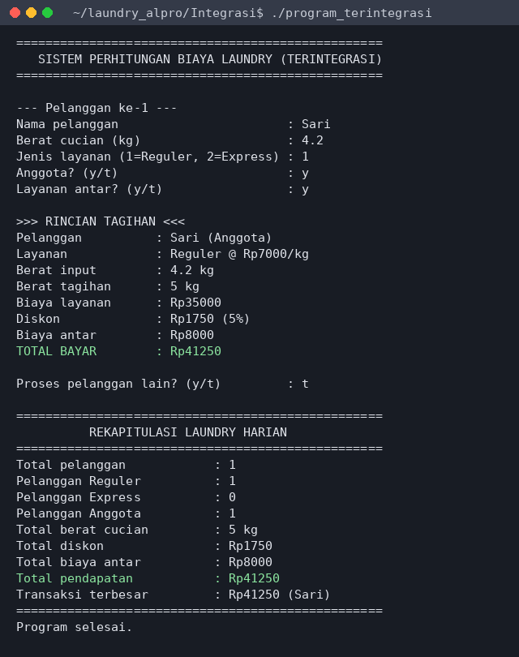
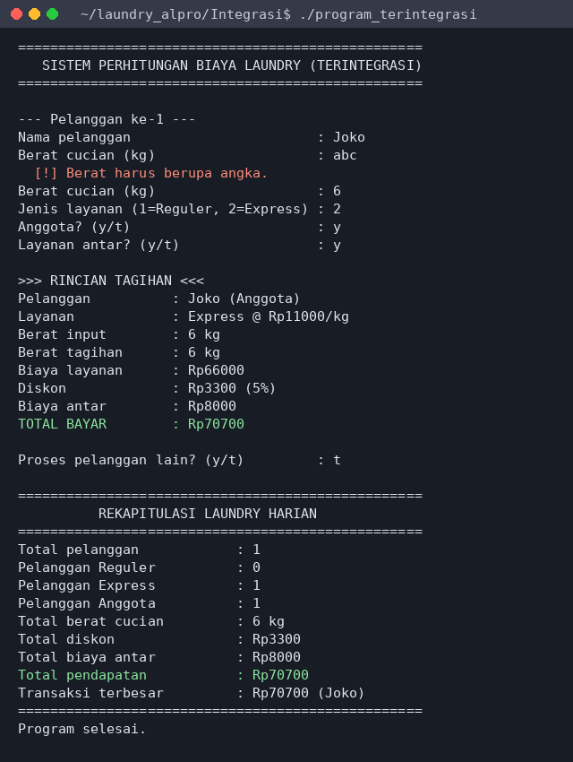
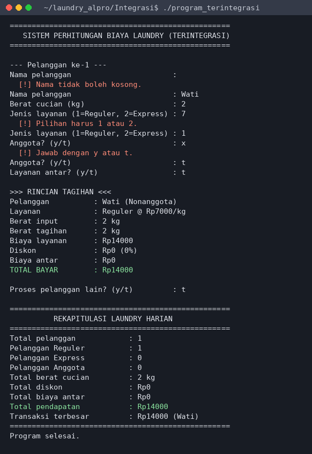
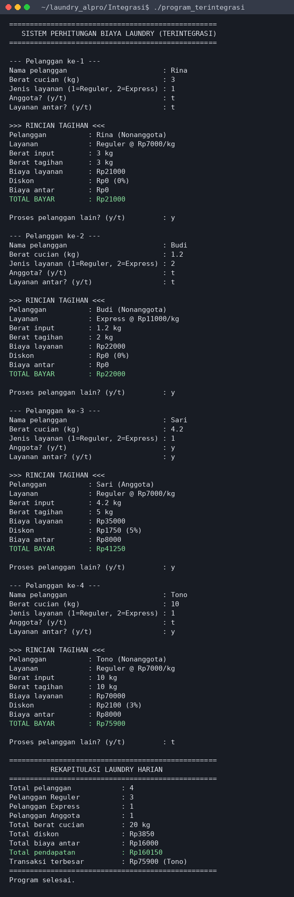

# Hasil Eksekusi dan Pengujian: Program Terintegrasi (Modul A + Modul B)

Pengujian dilakukan dengan menjalankan program hasil kompilasi `g++ -std=c++11 -Wall -Wextra` (tanpa warning). Setiap skenario di bawah dijalankan, lalu hasil aktual dibandingkan dengan perhitungan manual. **12 dari 12 skenario berhasil.**

Pengujian mencakup: input normal, batas bawah, batas atas, beberapa kondisi diskon, nilai nol, input negatif, dan input tidak valid lainnya.

## Tabel Pengujian

| No | Skenario | Data masukan | Hasil yang diharapkan | Hasil aktual | Status |
|:-:|---|---|---|---|:-:|
| 1 | Input normal | Rina ; 3 ; 1 ; t ; t | berat tagihan 3 kg; diskon 0% (Rp0); antar Rp0; total Rp21.000; rekap pendapatan sama | total Rp21.000 | Berhasil |
| 2 | Batas bawah berat (<2 kg dihitung 2 kg) | Budi ; 1.2 ; 2 ; t ; t | berat tagihan 2 kg; diskon 0% (Rp0); antar Rp0; total Rp22.000; rekap pendapatan sama | total Rp22.000 | Berhasil |
| 3 | Pembulatan ke atas, anggota 5 kg, antar | Sari ; 4.2 ; 1 ; y ; y | berat tagihan 5 kg; diskon 5% (Rp1.750); antar Rp8.000; total Rp41.250; rekap pendapatan sama | total Rp41.250 | Berhasil |
| 4 | Anggota 4 kg (tepat di bawah batas diskon) | Dewi ; 4 ; 1 ; y ; t | berat tagihan 4 kg; diskon 0% (Rp0); antar Rp0; total Rp28.000; rekap pendapatan sama | total Rp28.000 | Berhasil |
| 5 | Nonanggota 9 kg (belum dapat diskon) | Agus ; 9 ; 2 ; t ; t | berat tagihan 9 kg; diskon 0% (Rp0); antar Rp0; total Rp99.000; rekap pendapatan sama | total Rp99.000 | Berhasil |
| 6 | Nonanggota 10 kg (batas diskon 3%) + antar | Tono ; 10 ; 1 ; t ; y | berat tagihan 10 kg; diskon 3% (Rp2.100); antar Rp8.000; total Rp75.900; rekap pendapatan sama | total Rp75.900 | Berhasil |
| 7 | Batas atas kapasitas 100 kg | Maya ; 100 ; 2 ; y ; y | berat tagihan 100 kg; diskon 5% (Rp55.000); antar Rp8.000; total Rp1.053.000; rekap pendapatan sama | total Rp1.053.000 | Berhasil |
| 8 | Berat melebihi batas atas (150 kg) ditolak | Eko ; 150 lalu 2 ; 1 ; t ; t | berat tagihan 2 kg; diskon 0% (Rp0); antar Rp0; total Rp14.000; rekap pendapatan sama; input salah ditolak, program tetap lanjut | total Rp14.000; pesan penolakan muncul, program lanjut | Berhasil |
| 9 | Berat nol ditolak | Lia ; 0 lalu 3 ; 1 ; t ; t | berat tagihan 3 kg; diskon 0% (Rp0); antar Rp0; total Rp21.000; rekap pendapatan sama; input salah ditolak, program tetap lanjut | total Rp21.000; pesan penolakan muncul, program lanjut | Berhasil |
| 10 | Berat negatif ditolak | Ani ; -5 lalu 2.5 ; 1 ; t ; t | berat tagihan 3 kg; diskon 0% (Rp0); antar Rp0; total Rp21.000; rekap pendapatan sama; input salah ditolak, program tetap lanjut | total Rp21.000; pesan penolakan muncul, program lanjut | Berhasil |
| 11 | Berat berupa huruf ditolak | Joko ; abc lalu 6 ; 2 ; y ; y | berat tagihan 6 kg; diskon 5% (Rp3.300); antar Rp8.000; total Rp70.700; rekap pendapatan sama; input salah ditolak, program tetap lanjut | total Rp70.700; pesan penolakan muncul, program lanjut | Berhasil |
| 12 | Nama kosong, jenis layanan dan jawaban y/t tidak valid | (kosong) lalu Wati ; 2 ; 7 lalu 1 ; x lalu t ; t | berat tagihan 2 kg; diskon 0% (Rp0); antar Rp0; total Rp14.000; rekap pendapatan sama; input salah ditolak, program tetap lanjut | total Rp14.000; pesan penolakan muncul, program lanjut | Berhasil |

### Pengujian Sesi Beberapa Pelanggan

| Item rekap | Diharapkan | Aktual |
|---|--:|--:|
| Total pelanggan | 4 | 4 |
| Reguler | 3 | 3 |
| Express | 1 | 1 |
| Anggota | 1 | 1 |
| Total berat (kg) | 20 | 20 |
| Total diskon (Rp) | 3850 | 3850 |
| Total biaya antar (Rp) | 16000 | 16000 |
| Total pendapatan (Rp) | 160150 | 160150 |
| Transaksi terbesar (Rp) | 75900 | 75900 |
| Nama transaksi terbesar | Tono | Tono |

Status: **Berhasil**.

### Trace Table Percabangan (penentuan diskon)

Variabel yang dilacak: `anggota`, `beratTagihan`. Kondisi 1 = `anggota && beratTagihan >= 5`; Kondisi 2 = `!anggota && beratTagihan >= 10`.

| No | Pelanggan | anggota | beratTagihan | Kondisi 1 | Kondisi 2 | persenDiskon | Cocok dengan skenario |
|:-:|---|:-:|:-:|:-:|:-:|:-:|---|
| 1 | Sari | y | 5 | Benar | (dilewati) | 5 | Skenario 3 |
| 2 | Dewi | y | 4 | Salah | Salah | 0 | Skenario 4 |
| 3 | Agus | t | 9 | Salah | Salah | 0 | Skenario 5 |
| 4 | Tono | t | 10 | Salah | Benar | 3 | Skenario 6 |

### Trace Table Perulangan (4 pelanggan dalam satu sesi)

Data masukan berurutan: Rina (3 kg, Reguler, nonanggota, tanpa antar); Budi (1,2 kg, Express, nonanggota, tanpa antar); Sari (4,2 kg, Reguler, anggota, antar); Tono (10 kg, Reguler, nonanggota, antar). Jawaban "proses lagi?" adalah `y, y, y, t`.

| Iterasi | nama | beratTagihan | totalBayar | nomorPelanggan | jumlahReguler | jumlahExpress | jumlahAnggota | totalBerat | totalDiskon | totalAntar | totalPendapatan | transaksiTerbesar |
|:-:|---|:-:|--:|:-:|:-:|:-:|:-:|:-:|--:|--:|--:|--:|
| awal | - | - | - | 0 | 0 | 0 | 0 | 0 | 0 | 0 | 0 | 0 |
| 1 | Rina | 3 | 21000 | 1 | 1 | 0 | 0 | 3 | 0 | 0 | 21000 | 21000 |
| 2 | Budi | 2 | 22000 | 2 | 1 | 1 | 0 | 5 | 0 | 0 | 43000 | 22000 |
| 3 | Sari | 5 | 41250 | 3 | 2 | 1 | 1 | 10 | 1750 | 8000 | 84250 | 41250 |
| 4 | Tono | 10 | 75900 | 4 | 3 | 1 | 1 | 20 | 3850 | 16000 | 160150 | 75900 |

Setelah iterasi ke-4 jawaban `t`, perulangan berhenti dan rekapitulasi ditampilkan. Nilai baris terakhir sama dengan keluaran program (lihat gambar di bawah).

## Tangkapan Layar Terminal

**Skenario 3: pembulatan ke atas, diskon anggota, layanan antar**

**Skenario 11: input berat berupa huruf ditolak**

**Skenario 12: nama kosong, jenis layanan, dan jawaban y/t tidak valid**

**Sesi 4 pelanggan dan rekapitulasi**

