# Flowchart Modul B (Rekapitulasi Harian)

Pada Modul B setiap pelanggan tetap dihitung totalnya (agar bisa direkap), tetapi rincian tagihan tidak ditampilkan. Setelah pengguna mengakhiri perulangan, rekapitulasi harian ditampilkan satu kali.

```mermaid
flowchart TD
  A([Mulai]) --> B["nomorPelanggan = 0, semua akumulator = 0, transaksiTerbesar = 0"]
  B --> C
  C["nomorPelanggan = nomorPelanggan + 1"] --> D[/"Input namaPelanggan"/]
  D --> E{"Nama kosong?"}
  E -- Ya --> D
  E -- Tidak --> F[/"Input beratInput"/]
  F --> G{"Angka valid dan 0 < berat <= 100?"}
  G -- Tidak --> F
  G -- Ya --> H[/"Input jenisLayanan"/]
  H --> I{"jenisLayanan = 1 atau 2?"}
  I -- Tidak --> H
  I -- Ya --> J[/"Input anggota (y/t)"/]
  J --> K{"Jawaban y atau t?"}
  K -- Tidak --> J
  K -- Ya --> L[/"Input layananAntar (y/t)"/]
  L --> M{"Jawaban y atau t?"}
  M -- Tidak --> L
  M -- Ya --> N["beratTagihan = beratInput dibulatkan ke atas"]
  N --> N2{"beratTagihan < 2?"}
  N2 -- Ya --> N3["beratTagihan = 2"]
  N2 -- Tidak --> O{"jenisLayanan = 1?"}
  N3 --> O
  O -- Ya --> P["tarif = 7000"]
  O -- Tidak --> Q["tarif = 11000"]
  P --> R["biayaLayanan = beratTagihan x tarif"]
  Q --> R
  R --> S{"anggota DAN beratTagihan >= 5?"}
  S -- Ya --> T["persenDiskon = 5"]
  S -- Tidak --> U{"BUKAN anggota DAN beratTagihan >= 10?"}
  U -- Ya --> V["persenDiskon = 3"]
  U -- Tidak --> W["persenDiskon = 0"]
  T --> X["nominalDiskon = biayaLayanan x persenDiskon / 100"]
  V --> X
  W --> X
  X --> Y{"layananAntar?"}
  Y -- Ya --> Z1["biayaAntar = 8000"]
  Y -- Tidak --> Z2["biayaAntar = 0"]
  Z1 --> Z3["totalBayar = biayaLayanan - nominalDiskon + biayaAntar"]
  Z2 --> Z3
  Z3 --> Z5["Akumulasi: jumlah per jenis, anggota, berat, diskon, antar, pendapatan, transaksi terbesar"]
  Z5 --> UL
  UL[/"Input: proses pelanggan lain? (y/t)"/] --> VV{"Jawaban y atau t?"}
  VV -- Tidak --> UL
  VV -- Ya --> WW{"Jawaban = y?"}
  WW -- Ya --> C
  WW -- Tidak --> LP[/"Tampilkan rekapitulasi harian"/]
  LP --> End1([Selesai])
```

Simbol: oval = mulai/selesai, jajar genjang = input/output, persegi = proses, belah ketupat = keputusan.
